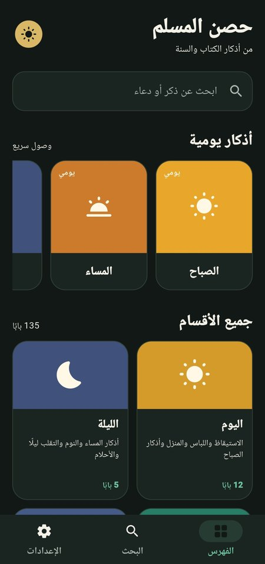
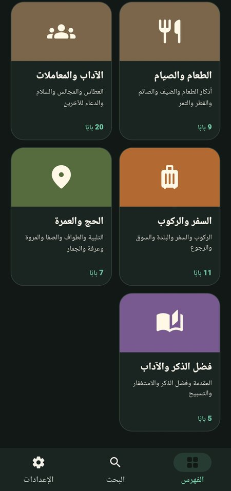
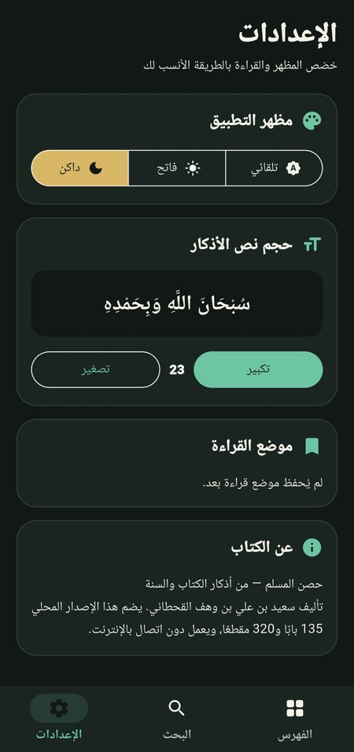

# حصن المسلم — Hisn al-Muslim

An offline Arabic **حصن المسلم** remembrance reader for Android, built with Flutter and Dart.

The app presents the book as a categorized, searchable, and comfortable reading experience. It works without an account, backend, or internet connection after installation.

> **How this was made:** this app was generated with AI assistance (Manus). I wrote the requirements, tested it on a phone and reviewed the content organisation. It is a hobby project that shows how I work with AI tools. It is not hand-written Flutter code.

## Screenshots

<p>
  
  
  
  
</p>

*Home, categories, search and settings (dark theme).*

## Features

- Complete offline Arabic حصن المسلم content.
- 135 book chapters and 320 remembrance blocks.
- 13 organized index categories, including separate sections for:
  - اليوم
  - الليلة
  - الأسرة
  - المرض
  - الوفاة
  - الطقس
  - الطعام والصيام
- Arabic text search with normalization for common Arabic letter variants and tashkeel.
- Smooth chapter reading with previous/next navigation.
- Saved reading position for each chapter.
- Adjustable reading font size.
- Light, dark, and system theme modes.
- Local persistence for theme, font size, and reading progress.
- Quick-access sections for commonly used remembrance groups.
- Fully offline data stored in the application assets.

## Screens and navigation

The main index displays category cards. Selecting a category opens its chapter list; selecting a chapter opens the reader. Search can be used to find chapters or words inside remembrance content.

The category organization changes only navigation metadata. The original Arabic remembrance text, references, chapter IDs, ordering, and reading blocks are preserved.

## Technology

- **Flutter / Dart**
- **Android SDK 36**
- **Minimum Android API:** 24
- **Package:** `com.hisnalmuslim.app`
- **Local storage:** `shared_preferences`
- **Content format:** bundled JSON asset
- **No backend or account system**

## Project structure

```text
lib/
├── controllers/       Application preferences and reading state
├── data/               Book repository and local data loading
├── models/             Book, category, chapter, and block models
├── screens/            Home, search, section, reader, and settings screens
├── theme/              Theme definitions and app styling
└── widgets/            Reusable cards and reader components

assets/
├── data/hisn-book.json   Complete offline Arabic book data
└── images/icon.png       Launcher and splash artwork

scripts/
└── split_categories.py   Reproducible category-only data transformation

test/                     Repository, persistence, navigation, and widget tests
android/                  Native Android project and build configuration
```


## Release signing

Do not commit private keystores, passwords, `android/key.properties`, or other signing credentials to GitHub. The public source archive intentionally excludes private signing files.

The current release line is **v1.0.2+3**. Future update builds must reuse the private release key associated with the installed v1.0.1/v1.0.2 releases. If the signing key is unavailable, Android will treat the APK as a different application update and require a fresh installation.

For personal development builds, Flutter can use the local debug key. For distributable release builds, restore the private signing configuration securely before running `flutter build apk --release`.

## Test and quality checks

Run the standard checks before opening a pull request:

```bash
dart format lib test
flutter analyze
flutter test --concurrency=1
```

The category tests verify that:

- All 135 chapters and 320 blocks remain available.
- Every chapter belongs to exactly one category.
- The separated categories contain the intended chapter IDs.
- Search and quick-access sections remain functional.
- Category-to-chapter-to-reader navigation works.
- Original chapter content remains unchanged.

## Data and attribution

This project is intended as an offline reading application. The bundled Arabic content and attribution information are kept in the repository’s data and source documentation. Please preserve those notices when redistributing or modifying the project.

